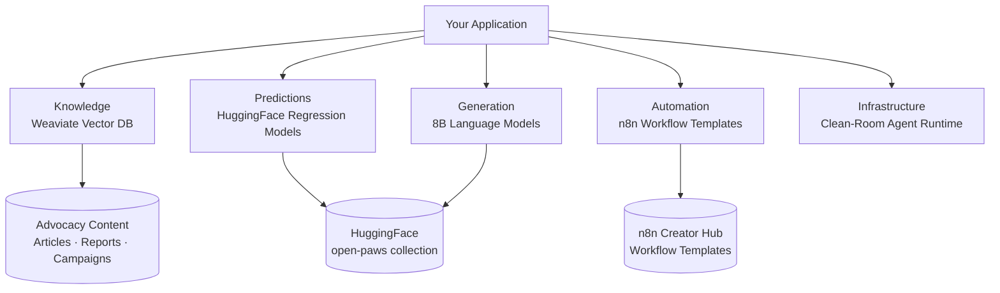

# Open Paws Documentation

[](LICENSE)
[](https://github.com/Open-Paws/documentation/commits/main)
[](https://huggingface.co/open-paws)

---

This repo is the developer documentation hub for Open Paws AI infrastructure — a purpose-built stack for animal advocacy organizations, researchers, and engineers. It covers the full AI stack: a Weaviate vector knowledge base, HuggingFace text regression prediction models, 8B language models, n8n workflow automations, and a clean-room agent architecture reference. If you are building advocacy tools, campaign automations, or fine-tuned models using Open Paws resources, start here.

> [!NOTE]
> This project is part of the [Open Paws](https://openpaws.ai) ecosystem — AI infrastructure for the animal liberation movement. [Explore the full platform →](https://github.com/Open-Paws)

Animal advocacy organizations are under-resourced relative to the industries they challenge. This documentation exists to lower the barrier for developers and technically capable advocates to build AI tools that actually move the needle — not adapted from generic use cases, but designed from the ground up for investigative research, campaign evaluation, and movement coordination.

---

## Architecture



Each section is self-contained: connection details, working code samples, and known limitations live together in one place.

---

## Quickstart

This repo contains no application code — there is nothing to build or deploy. Browse the section that matches your use case:

```bash
# Clone to browse locally
git clone https://github.com/Open-Paws/documentation.git
cd documentation

# Connect to the Weaviate knowledge base (requires your own OpenAI API key)
# See Knowledge/README.md for full connection details
export WEAVIATE_URL="https://larnd9rle1zwapsdcqw.c0.us-east1.gcp.weaviate.cloud"
export WEAVIATE_API_KEY="<read-only key in Knowledge/README.md>"
export OPENAI_APIKEY="<your key>"

# Run a prediction model (requires transformers)
pip install transformers torch
python -c "
from transformers import pipeline
p = pipeline('text-classification', model='open-paws/perceived_trustworthiness_prediction', return_all_scores=True)
print(p('Animals deserve to live free from exploitation.'))
"
```

See [Knowledge/README.md](Knowledge/README.md), [Predictions/README.md](Predictions/README.md), and [Generation/README.md](Generation/README.md) for complete working examples.

---

## Features

- **Weaviate vector knowledge base** — read-only public access to a vector-graph database of advocacy content (articles, reports, campaign materials, investigation findings) with per-document scoring across trustworthiness, insight, relevance, predicted performance, and more
- **Vector, hybrid, and filtered search** — query the knowledge base with semantic similarity, keyword weighting, and score-based filters; full RAG support via Weaviate's grouped-task generation
- **Text regression prediction models** — HuggingFace pipeline-compatible models scoring advocacy messages on performance metrics (social media analytics, sentiment) and human-preference dimensions (cultural sensitivity, emotional impact, persuasiveness)
- **8B advocacy language models** — Llama 3.1–based models continually pre-trained and instruction-tuned on animal advocacy content; optimized for local and low-memory deployment
- **n8n workflow templates** — ready-to-import automation templates for common advocacy workflows, hosted on the n8n Creator Hub; hosting options for teams, solo advocates, and high-security users
- **Clean-room agent architecture reference** — canonical patterns for shared tool registries, orchestration, operator controls, and safety boundaries across Open Paws projects
- **Training datasets** — six HuggingFace datasets covering supervised fine-tuning, continual pre-training, visual QA, alignment feedback, reasoning, and tool-use demonstrations

---

## Documentation

| Section | What it covers |
|---------|---------------|
| [Knowledge/README.md](Knowledge/README.md) | Weaviate connection, search patterns, RAG, schema, best practices |
| [Predictions/README.md](Predictions/README.md) | Prediction model usage, batch processing, score clipping |
| [Generation/README.md](Generation/README.md) | Language model loading, generation parameters, known limitations |
| [Automation/README.md](Automation/README.md) | n8n hosting options, workflow import guide |
| [Infrastructure/README.md](Infrastructure/README.md) | Agent runtime patterns, tool registry, safety boundaries |
| [CONTRIBUTING.md](CONTRIBUTING.md) | PR guidelines, writing style, quality gates |

---

<details>
<summary>Architecture detail</summary>

### Knowledge Infrastructure (Weaviate)

The knowledge base holds advocacy content scored across 11 dimensions. The `Content` collection is the primary entry point for RAG and semantic search:

```
Content
├── summary, main_text, content_type, source_url, date, tags
└── scores
    ├── good_for_animals, cultural_sensitivity, relevance
    ├── insight, trustworthiness, emotional_impact
    ├── rationality, influence, alignment
    └── predicted_performance, average_score
```

The recommended retrieval pattern is retrieve-and-re-rank: pull 20–30 results by vector similarity, then sort by composite score before passing to your application or generation step.

### Prediction Models

Models are text regression pipelines on HuggingFace. Outputs are continuous 0–1 scores but may exceed that range on out-of-distribution inputs — always clip before downstream use. Two model families exist:

- **Performance prediction** — trained on real-world advocacy metrics (social media and email marketing analytics, sentiment analysis of replies)
- **Preference prediction** — trained on human and synthetic feedback (cultural sensitivity, emotional impact, persuasiveness)

### Language Models

The 8B models are Llama 3.1 base with continual pre-training on animal advocacy content, followed by instruction tuning. Two variants:

- `open-paws/8B-base-model` — pre-trained only, no instruction tuning
- `open-paws/8B-instruct-chat` — chat-tuned instruct model

These are small models. Use them when local deployment on consumer hardware is a requirement. For complex tasks, use the models through the `open-paws` Weaviate RAG pipeline or a larger hosted model routed through OpenRouter.

### Agent Infrastructure

The clean-room agent architecture reference documents the shared runtime pattern used across Open Paws projects: scanner ingestion → structured export → platform orchestration → tool registry → human review before high-impact actions. See [Infrastructure/README.md](Infrastructure/README.md) for the full design and current implementation tracks.

</details>

---

## Contributing

See [CONTRIBUTING.md](CONTRIBUTING.md) for the full guide. Documentation contributions are welcome — particularly working code examples, integration guides for common patterns (RAG, batch inference, n8n automations), and corrections to known limitations. One topic per PR, under 200 lines where possible. The CI workflow enforces speciesist language rules automatically via [no-animal-violence](https://github.com/Open-Paws/no-animal-violence) — fix flagged terms rather than bypassing the check.

---

## License + Acknowledgments

[MIT License](LICENSE) — Copyright (c) 2025 Open Paws.

Built on [Weaviate](https://weaviate.io), [HuggingFace Transformers](https://huggingface.co/docs/transformers/), [Llama 3.1](https://www.llama.com/docs/) (Meta), and [n8n](https://docs.n8n.io). Datasets and models hosted at [huggingface.co/open-paws](https://huggingface.co/open-paws).

---

[Donate](https://openpaws.ai/donate) · [Discord](https://discord.gg/openpaws) · [openpaws.ai](https://openpaws.ai) · [Volunteer](https://openpaws.ai/volunteer)

---

## Metadata

```yaml
tech_stack: [Weaviate, Python, HuggingFace Transformers, Llama 3.1, n8n, Markdown]
project_status: stable
difficulty: intermediate
skill_tags: [vector-search, RAG, text-regression, language-models, workflow-automation, animal-advocacy, AI-infrastructure]
related_repos: [platform, gary, project-compassionate-code, graze-cli, context]
```
